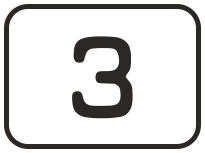
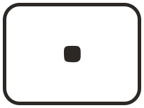
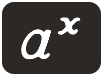
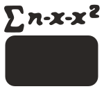
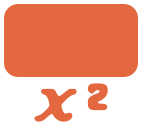
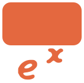

# Compucorp 326 Scientist key icons

Vector icons of the 326 keys and switches, traced from the 600 dpi scan of the *Beta 326 Scientist* manual, Appendix C (pp. 170–173, scans 0182–0185).

* `svg/`: vector files at the size printed in the manual. A large key is 8.3 × 6.1 mm.
* `png/`: 1200 dpi transparent PNGs, for apps that do not accept SVG.

Key bodies are redrawn as clean rounded rectangles at the measured size. The legends and labels are traced from the scan, so the lettering is the manual's own.

Colours: ink `#2B2826`, orange `#E4683F`; white key faces are filled `#FFFFFF`.

To show a shifted function, place `key_f` before the orange key, as the manual does, e.g.  .

## White (outlined) keys

| Icon | File | Key |
|---|---|---|
|  | `key_CLEAR` | CLEAR |
|  | `key_RESET` | RESET |
|  | `key_0` | 0 |
|  | `key_1` | 1 |
|  | `key_2` | 2 |
|  | `key_3` | 3 |
|  | `key_4` | 4 |
|  | `key_5` | 5 |
|  | `key_6` | 6 |
|  | `key_7` | 7 |
|  | `key_8` | 8 |
|  | `key_9` | 9 |
|  | `key_POINT` | Decimal point |
|  | `key_CHG_SIGN` | CHG SIGN |
|  | `key_EXP` | EXP |
|  | `key_DMS` | D/M/S |
|  | `key_SET_DP` | SET D.P. |

## Black keys

| Icon | File | Key |
|---|---|---|
|  | `key_PLUS` | + |
|  | `key_MINUS` | − |
|  | `key_TIMES` | × |
|  | `key_DIVIDE` | ÷ |
|  | `key_EQUALS` | = |
|  | `key_OPEN_PAREN` | ( |
|  | `key_CLOSE_PAREN` | ) |
|  | `key_ST` | ST n |
|  | `key_RCL` | RCL n |
|  | `key_A_POW_X` | a^x |
|  | `key_START_STOP` | START/STOP |

## The gold/orange function key

| Icon | File | Key |
|---|---|---|
|  | `key_f` | f (function key) |

## Small dark function keys (legend above)

| Icon | File | Key |
|---|---|---|
|  | `key_SQRT` | √ |
|  | `key_RECIPROCAL` | 1/X |
|  | `key_SIN` | SIN |
|  | `key_COS` | COS |
|  | `key_TAN` | TAN |
|  | `key_TO_RECT` | TO RECT |
|  | `key_LN` | Ln |
|  | `key_LOG` | LOG |
|  | `key_SIGMA` | Σ n·x·x² |
|  | `key_TO_METRIC` | →METRIC |

## Small dark programming keys (legend above)

| Icon | File | Key |
|---|---|---|
|  | `key_JUMP` | JUMP |
|  | `key_INSERT` | INSERT |
|  | `key_FWD` | FWD |
|  | `key_BACK` | BACK |

## Shifted functions, reached with f first (legend below)

| Icon | File | Key |
|---|---|---|
|  | `fn_ANGLE_DEC` | ∠↔DEC |
|  | `fn_X_SQUARED` | x² |
|  | `fn_X_FACTORIAL` | x! |
|  | `fn_ARC_SIN` | SIN⁻¹ |
|  | `fn_ARC_COS` | COS⁻¹ |
|  | `fn_ARC_TAN` | TAN⁻¹ |
|  | `fn_TO_POLAR` | TO POLAR |
|  | `fn_E_POW_X` | eˣ |
|  | `fn_TEN_POW_X` | 10ˣ |
|  | `fn_DELETE` | Σ DELETE |
|  | `fn_METRIC_TO` | METRIC→ |
|  | `fn_BRANCH` | BRANCH |
|  | `fn_REMOVE` | REMOVE |
|  | `fn_LABEL` | LABEL |
|  | `fn_RETURN` | RETURN |

## Slide switches (white window = switch position)

| Icon | File | Key |
|---|---|---|
|  | `switch_GRAD` | GRAD/DEG switch – GRAD |
|  | `switch_DEG` | GRAD/DEG switch – DEG |
|  | `switch_RUN` | RUN/STEP/LOAD switch – RUN |
|  | `switch_STEP` | RUN/STEP/LOAD switch – STEP |
|  | `switch_LOAD` | RUN/STEP/LOAD switch – LOAD |
|  | `switch_PROGRAM` | PROGRAM/REGISTERS switch – PROGRAM |
|  | `switch_REGISTERS` | PROGRAM/REGISTERS switch – REGISTERS |
